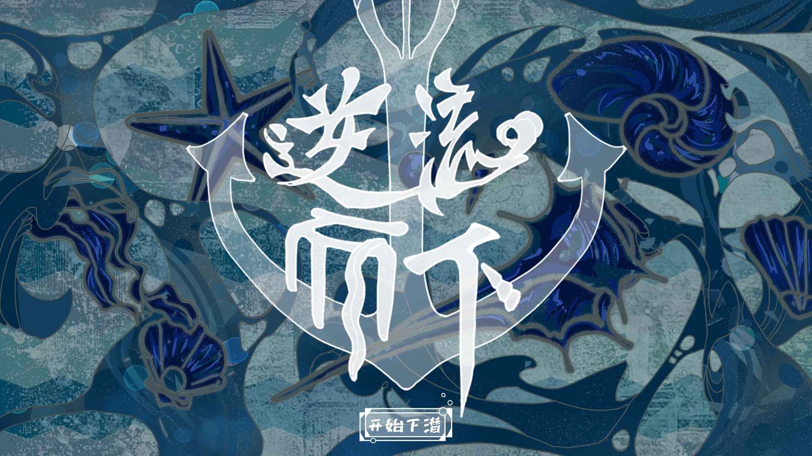
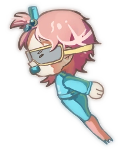
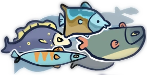
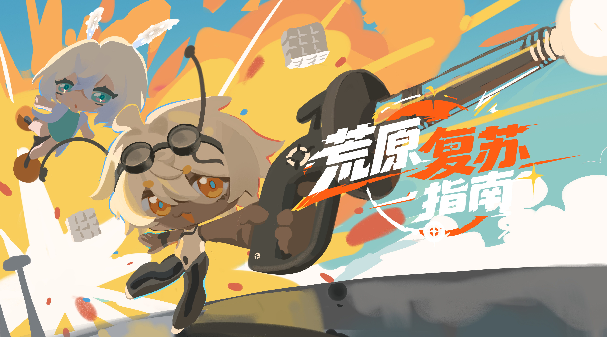
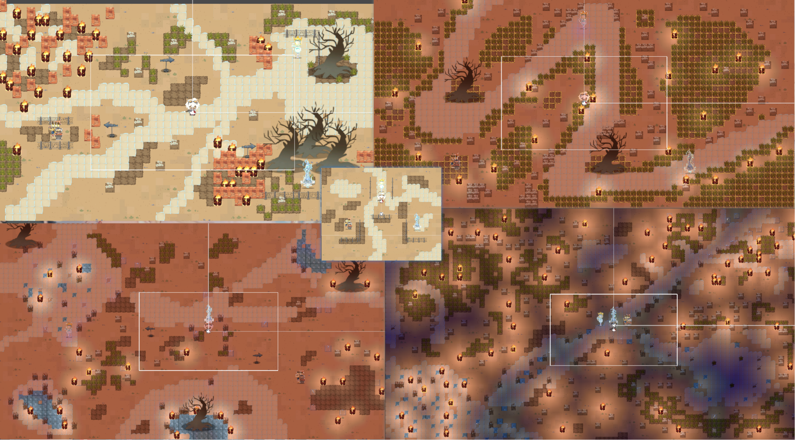
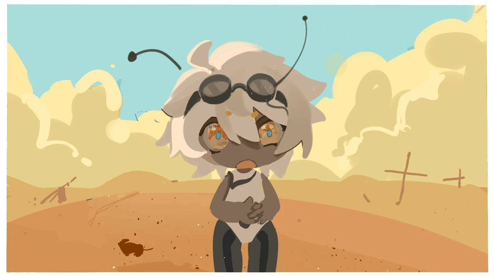
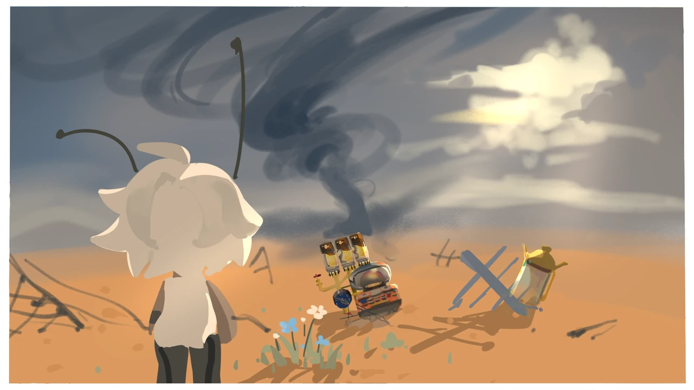
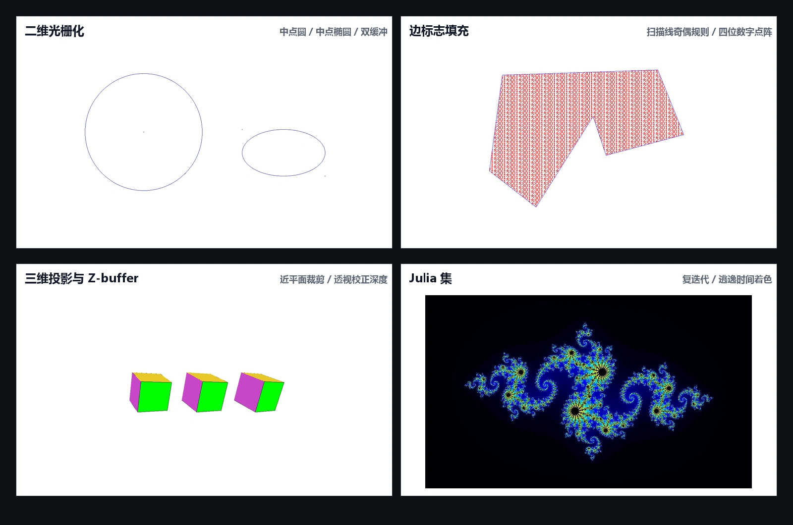

  

<h1 align="center">V-Reason / 愚人舟</h1>

  

专注 Unity 2D 玩法系统、自定义渲染与交互手感，具备 C++ 图形算法与研发工具链实战经验。

<a href="#游戏作品">游戏作品</a> &nbsp;·&nbsp; <a href="#基础知识">基础知识</a> &nbsp;·&nbsp; <a href="#ai-工具">AI 工具</a> &nbsp;·&nbsp; <a href="#技术栈与活跃度">技术栈与活跃度</a>

 

---

## 游戏作品

### 01 · 《逆流而下》 · `no-name-yet`

> 团队协作项目 · 职责：**玩法程序**（运动物理 / 交互状态）

  

  

横版深海冒险闯关。负责水下持续浮力对抗下的角色运动物理、锚点钩爪与铁链交互逻辑，以及状态切换和环境障碍反馈，保障高频操作下的连续手感。

- **入口**：[GitHub 仓库](https://github.com/V-Reason/no-name-yet) &nbsp;|&nbsp; [B 站实机演示](https://www.bilibili.com/video/BV1BRT16mErS/)

&nbsp;&nbsp;&nbsp;&nbsp;&nbsp;&nbsp;&nbsp;&nbsp;&nbsp;

 

### 02 · 《荒原复苏指南》 · `deepseaoil`

> 团队协作项目 · 职责：**核心程序**（分层架构 / 元素连锁 / 2D 光照渲染）

&nbsp;

  

俯视角 2D 策略生存追逐战。主导四层程序集架构拆分、组合根调度、数据驱动地块元素连锁反应，并落地输入缓冲、受击脱困及对象池热路径优化。

渲染侧自研微型瓦片网格 `TileGridLightmap` 扩散光场，协同 `CelLit` 着色器驱动昼夜环境光照与受击反馈，兼顾手绘质感与运行效率。

- **入口**：[GitHub 仓库](https://github.com/V-Reason/deepseaoil) &nbsp;|&nbsp; [B 站实机演示](https://www.bilibili.com/video/BV1SFn16aEy6/)

&nbsp;

  

 

---

## 基础知识

  

| 项目 | 技术栈 | 核心职责与成果 |
| --- | --- | --- |
| [`Game-DevKits`](https://github.com/V-Reason/Game-DevKits) | `C# / .NET Standard` · Unity 适配 | 将实战玩法与工程系统抽离为引擎无关的可测范式，涵盖状态机、输入缓冲、规则表、流场寻路与资产生命周期 |
| [`CGGraphicsLab`](https://github.com/V-Reason/CGGraphicsLab) | `C++ / MFC` | 解耦 `RasterCore` 算法核与双缓冲画布，独立实现光栅化、扫描线填充、近裁剪、`1/z` 消隐、曲线曲面与凸多边形求交 |

  

 

---

## AI 工具

  

| 项目 | 技术栈 | 核心职责与成果 |
| --- | --- | --- |
| [`agent-workflow-kit`](https://github.com/V-Reason/agent-workflow-kit) | `Python` | 本地多角色 AI 研发工作流，通过声明式 Profile、写边界隔离、人工审批门禁与 Git Diff 审计约束工程改动 |
| [`dsh-study-buddy`](https://github.com/V-Reason/dsh-study-buddy) | `TypeScript` | 面向技术梳理的插件与 Agent 预设，打通资料读取、自适应讲解、问答追踪与 Obsidian 归档闭环及契约校验 |

 

---

## 技术栈与活跃度

<a href="https://github.com/V-Reason?tab=repositories"><picture><source media="(prefers-color-scheme: dark)" srcset="https://skillicons.dev/icons?i=cs,unity,dotnet,cpp,py,ts,git&theme=dark" /><source media="(prefers-color-scheme: light)" srcset="https://skillicons.dev/icons?i=cs,unity,dotnet,cpp,py,ts,git&theme=light" /></picture></a>

<a href="https://github.com/V-Reason"><picture><source media="(prefers-color-scheme: dark)" srcset="https://github-readme-activity-graph.ashutosh-dwivedi0710.workers.dev/graph?username=V-Reason&bg_color=2b2a28&color=f7f0e7&title_color=d0b185&line=85c6c8&point=da684c&area=true&area_color=85c6c8&radius=6&hide_border=true&custom_title=Recent%20Activity" /><source media="(prefers-color-scheme: light)" srcset="https://github-readme-activity-graph.ashutosh-dwivedi0710.workers.dev/graph?username=V-Reason&bg_color=f7f0e7&color=343433&title_color=5f5a52&line=5b9a9d&point=da684c&area=true&area_color=85c6c8&radius=6&hide_border=true&custom_title=Recent%20Activity" /></picture></a>

<code>C# / Unity</code> · <code>C++ / MFC</code> · <code>Python</code> · <code>TypeScript</code> &nbsp;|&nbsp; <a href="https://github.com/V-Reason">查看实时提交记录 →</a>

 

---

  

  

<a href="https://github.com/V-Reason?tab=repositories">公开仓库</a> &nbsp;·&nbsp; <a href="https://www.bilibili.com/video/BV1BRT16mErS/">《逆流而下》实机</a> &nbsp;·&nbsp; <a href="https://www.bilibili.com/video/BV1SFn16aEy6/">《荒原复苏指南》实机</a> &nbsp;·&nbsp; <a href="mailto:vreason@qq.com">vreason@qq.com</a>

